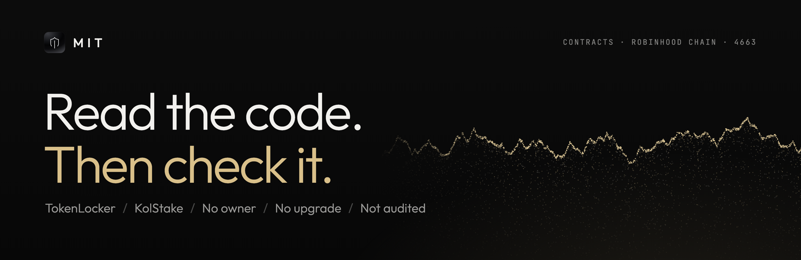
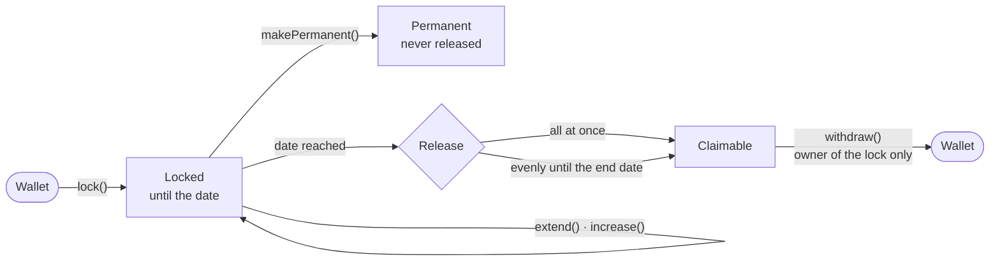
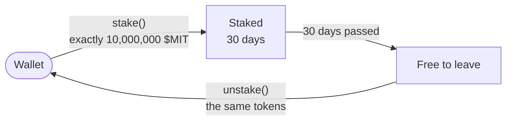

<p align="center"></p>

<h3 align="center">MIT contracts on Robinhood Chain</h3>

<p align="center"><i>The code that holds other people's tokens, its tests, and a way to check it against the chain yourself.</i></p>

<p align="center">
  
  
  
  
  
  
</p>

<p align="center">
  <a href="https://cryptoledgersociety.com/platform/">App</a> ·
  <a href="https://cryptoledgersociety.com/docs/">Docs</a> ·
  <a href="docs/CONTRACTS.md">Contracts</a> ·
  <a href="#check-it-yourself">Check it yourself</a> ·
  <a href=".github/SECURITY.md">Security</a>
</p>

---

A lock page that says "locked" proves nothing. What proves it is the contract: who can take the tokens out, when, and whether anyone can
change those rules later. This repository holds the two contracts MIT runs on Robinhood Chain (chain ID 4663), so you can read the rules
and confirm that the code at the address is the code here.

## What MIT is

MIT is a set of trading tools on Robinhood Chain, opened by one token, $MIT. Most of it is software that runs on a server and never
holds your tokens. Two parts do hold tokens, so those two are contracts, and they are the ones published here.

| Tool | What it does | Holds your tokens? |
|---|---|---|
| **AI Super Agent** | Search any coin and get a read you can act on: Chart 3D with support and resistance, an entry, a target and a stop, projected candles, and the news behind the move | No. It only reads |
| **MIT AutoTrade** | Runs a strategy on your own Bybit or Lighter account, inside the limits you set: which coins, how many positions, how much per trade. Your funds stay in your account, and the exchange key it uses can trade but cannot withdraw | No. Funds stay on your exchange account |
| **Simulation** | Try a strategy on past data before you let it trade | No |
| **Traders** | A public board of results, sorted by profit and loss | No |
| **Track** | Check a token (trust score, tax, liquidity lock, the creator's past launches, look-alike tickers) or a wallet (profit and loss, where the money came from and went) | No. It only reads the chain |
| **Lock** | Lock any token until a date, released at once or over time, with a public link for every lock | **Yes: `TokenLocker`, in this repository** |
| **KOL stake** | Stake 10,000,000 $MIT for 30 days to get an affiliate code without asking anyone | **Yes: `KolStake`, in this repository** |
| **$MIT** | Pays for access, and a wallet holding enough gets a free trial | The token is Pons launchpad code, not ours |

Audit and Launch are planned and not open yet. Everything is in the [Launch App](https://cryptoledgersociety.com/platform/), and each
tool is explained in the [Docs](https://cryptoledgersociety.com/docs/).

MIT never asks for a private key or a seed phrase. Trading can lose money; none of these tools promises a result.

## How a lock lives



No arrow leads from **Locked** back to the wallet before the date, and no arrow belongs to MIT: the contract has no owner role.

## How a KOL stake lives



## Contracts

Solidity 0.8.26, no external libraries. **Not audited.** Reviewed and tested in-house only.

| Contract | Status | Address | What it guarantees |
|---|---|---|---|
| `TokenLocker` | **Live** | [`0x4213382292ba3bdccddfdbc8e0fbc9ffc31974c6`](https://robinhoodchain.blockscout.com/address/0x4213382292ba3bdccddfdbc8e0fbc9ffc31974c6?tab=contract) | Anyone can lock any ERC-20 token until a date, released at once or evenly over time. A lock can be made longer or larger, never shorter or smaller. No owner, no admin, no upgrade, no pause, no fee. Only the lock's owner can withdraw, and only what the schedule has released. |
| `KolStake` | **Live** | [`0xa8f2e7e31f54c6dddef7e9cbdd58689a85186a04`](https://robinhoodchain.blockscout.com/address/0xa8f2e7e31f54c6dddef7e9cbdd58689a85186a04) | A wallet stakes exactly 10,000,000 $MIT and can take the same tokens back after 30 days. No owner, no admin, no upgrade. No function can send a staker's tokens to anyone but that staker. |

Source verification on the explorer:

- `TokenLocker`: verified on Blockscout and Sourcify. Blockscout shows it as a *partial match* because the build leaves out the metadata hash; the running code itself matches byte for byte.
- `KolStake`: not verified on the explorer yet. You can check it yourself with the script below.

The $MIT token ([`0x219a665fcb5beec566052972926b723ad458b43c`](https://robinhoodchain.blockscout.com/token/0x219a665fcb5beec566052972926b723ad458b43c)) was created by the Pons launchpad. Its contract is Pons's code, not ours, so it is not in this repository.

## Check it yourself

You do not have to trust the explorer or us. This builds both contracts on your machine and compares them with the code at the addresses above:

```bash
git clone --depth 1 --branch v1.17.0 https://github.com/foundry-rs/forge-std lib/forge-std
python3 scripts/check_bytecode.py
```

```text
TokenLocker  0x4213382292ba3bdccddfdbc8e0fbc9ffc31974c6  MATCH  (6710 bytes)
KolStake     0xa8f2e7e31f54c6dddef7e9cbdd58689a85186a04  MATCH  (2429 bytes)
```

It needs [Foundry](https://book.getfoundry.sh/getting-started/installation) and Python 3, and reads the chain through the public RPC. Set `RPC_URL` to use another one.

## Run the tests

```bash
git clone --depth 1 --branch v1.17.0 https://github.com/foundry-rs/forge-std lib/forge-std   # once

cd locker && forge test          # 23 tests, including fuzz
cd ../kolstake && forge test     # 19 tests, including fuzz
```

The fork tests run against the real tokens on a copy of Robinhood Chain and are skipped unless you pass a fork:

```bash
cd locker && forge test --match-contract ForkTest --fork-url https://rpc.mainnet.chain.robinhood.com
```

## Who can do what

**TokenLocker**

| | The lock's owner | Anyone else | MIT |
|---|---|---|---|
| Lock tokens | yes | yes, for themselves or for another wallet | same as anyone |
| Withdraw before the date | no | no | no |
| Withdraw what the schedule has released | yes | no | no |
| Make a lock longer, larger or permanent | yes | no | no |
| Make a lock shorter or smaller | no | no | no |
| Hand a lock to another wallet | yes, and the other wallet must accept | no | no |
| Pause, upgrade or change the contract | no | no | no |

**KolStake**

| | The staker | Anyone else | MIT |
|---|---|---|---|
| Stake | yes | yes, for themselves | same as anyone |
| Unstake before 30 days | no | no | no |
| Unstake after 30 days | yes, the same tokens | no | no |
| Move a staker's tokens | no one else can | no | no |
| Pause, upgrade or change the contract | no | no | no |

## What to know before you use them

- **Not audited.** No third party has reviewed these contracts. Use amounts you are comfortable with.
- **Tokens sent straight to a contract address are lost.** Only tokens passed through `lock()` or `stake()` belong to someone.
- **A permanent lock cannot be undone.** That is the point of it.
- **Rebasing tokens are not supported** in `TokenLocker`. Tokens that take a fee on transfer are credited with what actually arrived; `KolStake` refuses them.
- **One sequencer runs Robinhood Chain.** If it stops, transactions stop with it.
- The contracts were deployed from a single wallet. That wallet has no power over either contract after deployment: there is no owner role to hold.

## What is not here

The code of the other tools (AI Super Agent, AutoTrade, Simulation, Track, the server and its data) is not open source. This repository holds only the contracts, because those are the parts that hold other people's tokens.

## What is here

| Folder | What |
|---|---|
| [`locker/`](locker/) | `TokenLocker`: source, tests, and the exact compiler input used to verify it |
| [`kolstake/`](kolstake/) | `KolStake`: source, tests, and its compiler input |
| [`scripts/`](scripts/) | `check_bytecode.py`: compares the deployed code with a fresh build |
| [`docs/`](docs/) | [`CONTRACTS.md`](docs/CONTRACTS.md): every function, event and rule |

## Status

Both contracts are live on Robinhood Chain mainnet and in use. Neither is audited. Neither can be changed: what you read here is what runs
for as long as the chain does.

## Security

Report a problem privately: see [SECURITY.md](.github/SECURITY.md).

## License

[MIT](LICENSE)
